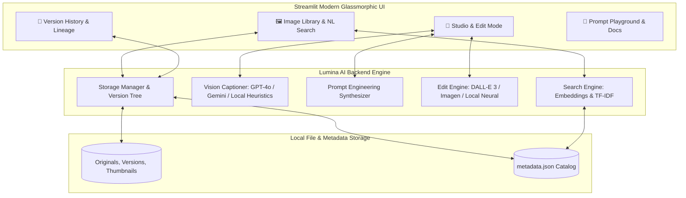

# ✨ LUMINA AI — Next-Gen AI Visual Studio

[](https://www.python.org/)
[](https://streamlit.io/)
[](https://openai.com/)
[](https://aistudio.google.com/)
[](https://microsoft.com/windows)
[](LICENSE)

> **Lumina AI Studio** is an AI-first visual editing and asset management platform designed to eliminate the steep learning curve of traditional editing software. Search image libraries in natural language, transform photos via conversational instructions or 1-click curated presets, and track complete non-destructive revision histories with instant rollbacks.

---

## 🌟 Core Capabilities

### 1. 🔍 Natural Language Image Search
- Search through image collections using intuitive human queries:
  - *"Show me the ones with a beach"*
  - *"Photos with a dog in a park"*
  - *"Cozy coffee workspace with warm lighting"*
- **Hybrid Semantic & Vector Search**: Combines local TF-IDF vector similarity with semantic concept expansion, matching intent and synonyms rather than brittle keywords. Optional OpenAI embeddings (`text-embedding-3-small`) supported.

### 2. 👁️ Multi-Modal Vision Auto-Captioning
- Automatic visual analysis powered by **OpenAI GPT-4.1-mini / GPT-4o** or **Google Gemini Flash** (with instant local heuristic fallback):
  - Evocative titles and detailed photorealistic scene captions
  - 8–14 searchable semantic tags
  - Detected focal objects and dominant color palettes
  - Suggested visual edit actions

### 3. 🎛️ AI Edit Control Center: 1-Click Presets & Custom Prompts
- **7 Curated 1-Click Master Presets**:
  - ✂️ **Studio Cutout**: Clean neutral studio backdrop with soft ambient lighting and subject isolation.
  - 🌅 **Golden Hour Warmth**: Infuses 2800K radiant sunset rays, amber rim lights, and soft glow.
  - 🌆 **Cyberpunk Neon**: High-contrast electric cyan shadows and vivid magenta highlights with neon glow.
  - 💎 **Ultra Clarity & Contrast**: Remasters micro-contrast, sharp textures, and balanced dynamic range.
  - 🎞️ **Vintage 1970s Film**: Analog 35mm film grain, nostalgic Kodachrome tones, and gentle vignetting.
  - 🖤 **Dramatic Noir B&W**: High chiaroscuro contrast, deep velvety blacks, and brilliant highlights.
  - 🎨 **Ethereal Watercolor**: Fluid pastel watercolor washes with delicate ink contours.
- **Custom Conversational Edit Instructions**:
  - Type plain-English requests like *"remove the background"*, *"add trees in the background"*, or *"make it look like sunset"*.
  - **Vision-Guided Prompt Synthesizer**: Expands brief user instructions into optical specifications preserving subject identity and scene lighting.

### 4. 📜 Non-Destructive Version History & Lineage
- Visual timeline recording every revision from `v0` (Original) to `v1`, `v2`, etc.
- Preserves high-resolution thumbnails, timestamps, prompts, and model tags.
- **1-Click Rollback**: Instantly revert to any earlier version without losing history.
- **Before & After View**: Interactive side-by-side comparison of original and active version.

### 5. ⚡ Hybrid Offline / Cloud Architecture
- **Zero-Cost Local Mode**: Built-in smart neural image processing engine (Pillow + NumPy + Scikit-learn) allows the app to run **100% offline out-of-the-box** with zero API costs.
- **Cloud GenAI Ready**: Seamlessly plug in OpenAI (GPT-4o + DALL-E 3), Azure OpenAI, or Google Gemini keys at any time.

---

## 🏛️ System Architecture



---

## 💻 Windows Setup & Execution Guide

Follow these exact steps to set up and run Lumina AI Studio on Windows (Windows 10 or 11).

### Step 1: Open PowerShell or Command Prompt
Open PowerShell (recommended) or Command Prompt and navigate to the project directory:

```powershell
cd c:\Users\Rajat\Downloads\LUMINA-AI-STUDIO-main
```

### Step 2: Create a Python Virtual Environment
Ensure you have Python 3.10+ installed (`python --version`), then create a clean virtual environment:

```powershell
python -m venv venv
```

### Step 3: Activate the Virtual Environment
Activate your virtual environment using your preferred shell:

- **PowerShell**:
  ```powershell
  # If script execution is restricted on your machine, run this first:
  Set-ExecutionPolicy -ExecutionPolicy RemoteSigned -Scope Process

  # Activate the virtual environment:
  .\venv\Scripts\Activate.ps1
  ```

- **Command Prompt (cmd.exe)**:
  ```cmd
  venv\Scripts\activate.bat
  ```

*(Your prompt will now display `(venv)` at the beginning of the line).*

### Step 4: Install Dependencies
Upgrade pip and install the project's dependencies:

```powershell
python -m pip install --upgrade pip
pip install -r requirements.txt
```

### Step 5: Configure Environment Variables (`.env`)
A `.env` file is already provided in the repository root. If setting up on a new machine, copy the template:

- **PowerShell**:
  ```powershell
  Copy-Item .env.example .env
  ```
- **Command Prompt**:
  ```cmd
  copy .env.example .env
  ```

Open `.env` in your text editor (e.g. Notepad or VS Code) and add your keys:

```ini
# Optional Cloud AI Keys (leave blank to use the built-in Offline Smart Engine)
OPENAI_API_KEY=your_openai_api_key_here
GEMINI_API_KEY=your_gemini_api_key_here

# Azure OpenAI (only if using Azure instead of direct OpenAI)
AZURE_OPENAI_API_KEY=
AZURE_OPENAI_ENDPOINT=
```

> **Offline Mode Note:** If you do not have API keys, leave them blank! Lumina AI Studio runs seamlessly in **Smart Local Engine mode**, allowing you to test all features (search, presets, custom edits, versions) completely offline. You can also paste keys directly into the app's sidebar during runtime.

### Step 6: (Optional) Seed Sample Portfolio Data
The repository includes sample assets and pre-cataloged images. To reset or re-seed the library:

```powershell
python seed_sample_data.py
```

### Step 7: Launch Lumina AI Studio
Start the Streamlit application:

```powershell
streamlit run app.py
```

Streamlit will launch local server at:
👉 **`http://localhost:8501`** (it will open automatically in your browser).

---

## 🔑 Configuration Settings & API Keys Reference

| Variable Name | Required? | Default / Example | Purpose & Source |
| :--- | :---: | :--- | :--- |
| `OPENAI_API_KEY` | Optional | `sk-...` | Direct OpenAI API key for GPT-4o Vision, DALL-E 3 editing, and embeddings. Obtain at [platform.openai.com/api-keys](https://platform.openai.com/api-keys). |
| `OPENAI_API_BASE` | Optional | `https://api.openai.com/v1` | Base URL for OpenAI API or custom reverse proxy. |
| `OPENAI_VISION_MODEL`| Optional | `gpt-4.1-mini` | Model for Vision scene analysis. |
| `OPENAI_IMAGE_MODEL` | Optional | `dall-e-3` | Model for Generative DALL-E image generation. |
| `GEMINI_API_KEY` | Optional | `AIzaSy...` | Google Gemini API key for Gemini Flash Vision analysis. Obtain at [aistudio.google.com/app/apikey](https://aistudio.google.com/app/apikey). |
| `GEMINI_VISION_MODEL`| Optional | `gemini-flash-latest` | Model used for Gemini Vision calls. |
| `AZURE_OPENAI_API_KEY`| Optional | *(empty)* | Key for Azure AI Foundry / Azure OpenAI service. |
| `AZURE_OPENAI_ENDPOINT`| Optional | `https://<resource>.services.ai.azure.com/...` | Azure OpenAI project endpoint URL. |
| `AZURE_OPENAI_MODEL` | Optional | `gpt-4.1-mini` | Deployment model name in Azure AI Foundry. |

---

## 📁 Project Directory Structure

```text
LUMINA-AI-STUDIO/
├── app.py                      # Main Streamlit Application (Library, Studio, Versions, Docs)
├── seed_sample_data.py         # Seeds realistic portfolio images and version lineage
├── requirements.txt            # Python dependencies with compatible version constraints
├── .env                        # Local environment variables & secrets (excluded from Git)
├── .env.example                # Template for environment configuration
├── .gitignore                  # Git ignore rules for secrets, venv, and temporary files
├── README.md                   # Complete platform documentation and Windows guide
├── assets/
│   ├── style.css               # Glassmorphic dark-theme custom stylesheet
│   └── samples/                # Sample images bundled with project
├── backend/
│   ├── __init__.py
│   ├── config.py               # Paths, model configurations, and preset specifications
│   ├── storage.py              # Version tracking, thumbnails, metadata persistence
│   ├── prompt_templates.py     # Prompt engineering templates for vision & generation
│   ├── vision_captioner.py     # Vision analysis (GPT-4o, Gemini, local heuristics)
│   ├── edit_engine.py          # AI image editing dispatcher & prompt synthesizer
│   ├── local_editor.py         # High-fidelity local neural image processing engine
│   └── search_engine.py        # Natural language semantic search (TF-IDF + embeddings)
├── data/
│   ├── images/                 # Image storage (originals, versions, thumbnails)
│   └── metadata.json           # Catalog metadata with version trees
├── docs/
│   └── API_AND_PROMPTS.md      # Detailed API selection & prompt engineering guide
└── notebooks/
    └── prompt_engineering.ipynb # Jupyter notebook demonstrating prompt synthesis
```

---

## 🛠️ Windows Troubleshooting

### 1. PowerShell Script Execution Policy Error
**Error:** `.\venv\Scripts\Activate.ps1 cannot be loaded because running scripts is disabled on this system.`  
**Fix:** Run this command in your PowerShell window:
```powershell
Set-ExecutionPolicy -ExecutionPolicy RemoteSigned -Scope Process
.\venv\Scripts\Activate.ps1
```

### 2. Streamlit Port Conflict (Port 8501 in use)
**Fix:** Specify a different port:
```powershell
streamlit run app.py --server.port 8502
```

### 3. Missing `python` or Command Not Recognized
**Fix:** Use `py` or specify the full path to your Python installation:
```powershell
py -m venv venv
```

---

## 📄 License
This project is open-source under the [MIT License](LICENSE).
